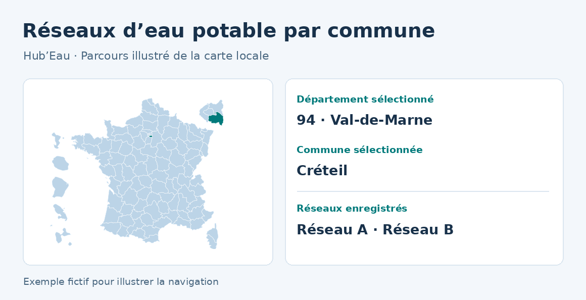

# Hub’Eau · Explorer les analyses d’eau potable

Application Flask réalisée en équipe. Elle réunit **un tableau qui interroge l’API Hub’Eau** et **une carte qui lit une base SQLite locale**. Ces deux vues répondent à des besoins différents : consulter des mesures publiées ou retrouver les réseaux rattachés à une commune.

## Parcours de démonstration

1. Ouvrir la carte, choisir un département puis une commune. Les réseaux affichés proviennent de la base installée avec le projet.
2. Ouvrir le tableau et trier les analyses par date, commune ou paramètre. La vue demande jusqu’à 1 000 résultats à l’API, les trie localement et en affiche 50. Les résultats dépendent des données publiées au moment de la consultation.
3. Lire le paramètre, l’unité et la valeur ensemble. Une mesure comme **<1** conserve le signe de comparaison transmis par la source.

Si l’API est indisponible, l’interface du tableau propose de réessayer. La carte utilise sa propre source de données.

## Parcours des données de la carte

Le script `prepare_data.py` extrait la base SQLite de l’archive du projet. La sélection d’un département récupère les communes enregistrées dans SQLite. La sélection d’une commune affiche ses réseaux de distribution. Les mesures du tableau viennent de l’API Hub’Eau via un parcours séparé.

## Démarrer en local

Prérequis : Python 3.12 ou 3.14 et un accès réseau pour le tableau. Créer puis activer un environnement virtuel avec `python -m venv .venv`. Sous PowerShell, utiliser `.\.venv\Scripts\Activate.ps1`. Sous macOS ou Linux, utiliser `source .venv/bin/activate`.

~~~sh
python -m pip install -r requirements.txt
python prepare_data.py
python -m flask --app app run
~~~

Ouvrir [localhost:5000](http://127.0.0.1:5000/). Le script de préparation extrait la base SQLite et le logo depuis `site-HubEau.zip`. Les modules `controller/` organisent les routes, et `model/` sépare l’accès SQLite et l’appel HTTP.

[Documentation de l’API Qualité de l’eau potable](https://hubeau.eaufrance.fr/page/api-qualite-eau-potable) · [Portfolio](https://kajan94.github.io/Portefolio/#hubeau)
